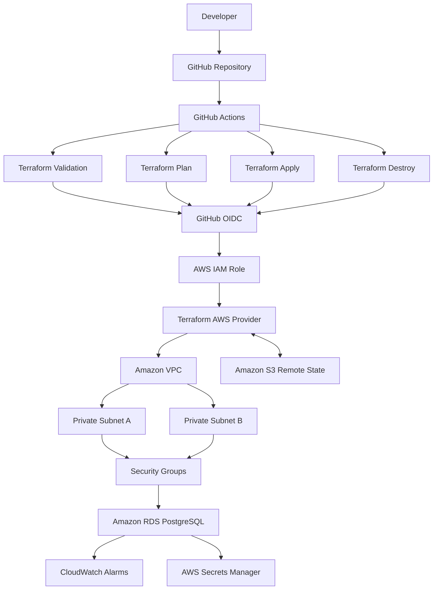

# AWS DevOps Platform — Terraform & GitHub Actions

**Infrastructure as Code · CI/CD Automation · AWS Networking · Drift Detection · Secure Cloud Operations**

An AWS DevOps portfolio project demonstrating the end-to-end lifecycle of cloud infrastructure: provisioning, automated deployment, monitoring, drift detection, troubleshooting, and controlled teardown.

Built with Terraform, AWS, and GitHub Actions, this project demonstrates Infrastructure as Code (IaC), secure OIDC authentication, remote state management, private database networking, operational monitoring, and infrastructure lifecycle management.

**Technology stack**


**Repository:** [imed3721/aws-devops-platform](https://github.com/imed3721/aws-devops-platform)

---

## Table of Contents

- [1. Project Overview](#1-project-overview)
- [2. Project Objectives](#2-project-objectives)
- [3. Architecture](#3-architecture)
- [4. AWS Infrastructure](#4-aws-infrastructure)
- [5. Security and Access Control](#5-security-and-access-control)
- [6. CI/CD and Terraform Workflows](#6-cicd-and-terraform-workflows)
- [7. Infrastructure Drift Detection](#7-infrastructure-drift-detection)
- [8. Cleanup and Final State](#8-cleanup-and-final-state)
- [9. Repository Structure](#9-repository-structure)
- [10. Project Evidence and Screenshots](#10-project-evidence-and-screenshots)
- [11. Key Skills Demonstrated](#11-key-skills-demonstrated)
- [12. Challenges and Lessons Learned](#12-challenges-and-lessons-learned)
- [13. Cost Management](#13-cost-management)
- [14. Future Improvements](#14-future-improvements)

## 1. Project Overview

This project demonstrates how AWS infrastructure can be defined, deployed, monitored, and managed using Terraform and GitHub Actions rather than relying entirely on manual configuration through the AWS Management Console.

Terraform defines the infrastructure as code, while GitHub Actions automates key stages of the infrastructure lifecycle, including validation, planning, deployment, and destruction.

GitHub Actions authenticates to AWS using OpenID Connect (OIDC) and an IAM role, avoiding the need to store long-lived AWS access keys in GitHub for workflow authentication.

The project also explores infrastructure drift: identifying differences between the intended Terraform configuration and the actual AWS environment, then reconciling those differences.

Finally, a manually triggered destruction workflow demonstrates how development infrastructure can be removed in a controlled manner.

## 2. Project Objectives

The main objectives of this project are to:

- Define AWS infrastructure using Terraform and version control.
- Automate Terraform validation, planning, and deployment with GitHub Actions.
- Configure federated AWS authentication using GitHub OIDC and IAM.
- Manage Terraform state remotely using Amazon S3 and S3 lock-file support.
- Deploy a private Amazon RDS for PostgreSQL database.
- Restrict database access using security groups.
- Configure CloudWatch alarms for database CPU utilisation and available storage.
- Introduce, detect, and reconcile infrastructure drift.
- Implement a manually triggered Terraform destruction workflow.
- Verify resource cleanup while retaining the Terraform state backend.

## 3. Architecture

The architecture connects the GitHub Actions automation workflow to AWS through federated authentication. Terraform manages the infrastructure and stores its state remotely in Amazon S3.



The diagram represents the project design and automation flow. Screenshots in Section 10 provide evidence of the infrastructure and workflow stages.

## 4. AWS Infrastructure

Terraform manages the AWS resources required for the development environment.

| Component | Purpose |
|---|---|
| Amazon VPC | Provides an isolated virtual network. |
| Private subnets | Provide network placement for private resources. |
| Security groups | Control permitted network traffic. |
| Amazon RDS for PostgreSQL | Provides a managed relational database. |
| RDS DB subnet group | Defines the subnets available to the database. |
| Amazon CloudWatch | Monitors database CPU utilisation and free storage. |
| AWS Secrets Manager | Integrates with RDS to manage the master password. |
| Amazon S3 | Stores Terraform state and the state lock file. |

### Network configuration

The development VPC uses the `10.20.0.0/16` IPv4 CIDR range.

Two subnets are configured:

- `10.20.1.0/24`
- `10.20.2.0/24`

Security groups control communication between the relevant infrastructure components.

### Database configuration

The project uses Amazon RDS for PostgreSQL with the following configuration:

| Setting | Configuration |
|---|---|
| Database engine | PostgreSQL |
| Instance class | `db.t3.micro` |
| Public accessibility | Disabled |
| Storage encryption | Enabled |
| Master password | Managed through AWS Secrets Manager |
| Network placement | Configured RDS DB subnet group |

Inbound PostgreSQL traffic on port `5432` is restricted to the application security group rather than being open to unrestricted inbound access.

### Monitoring and alerting

Two CloudWatch alarms are configured to monitor the database:

| Alarm | Threshold | Purpose |
|---|---:|---|
| High CPU utilisation | 80% | Identifies elevated database CPU utilisation. |
| Low free storage | 2 GiB | Identifies when available database storage falls below the configured threshold. |

These alarms demonstrate how monitoring resources can be defined and managed alongside the infrastructure they monitor.

## 5. Security and Access Control

Security is addressed through network restrictions, federated authentication, IAM permissions, encrypted database storage, and remote state management.

### GitHub Actions OIDC

GitHub Actions assumes an AWS IAM role through OpenID Connect. This avoids the need for long-lived AWS access keys in GitHub workflow configuration.

The IAM role trust policy restricts access to the configured repository context, including the authorised branch and deployment environment.

### IAM permissions

The workflow role has permissions for the AWS operations required by Terraform, including:

- VPC, subnet, security group, and network interface discovery.
- RDS instance and subnet group management.
- CloudWatch alarm management.
- Amazon S3 state access and lock-file operations.
- Supporting permissions required by the configured deployment.

The role must have sufficient permissions for both provisioning and destruction. The initial teardown attempt exposed a missing `ec2:DescribeNetworkInterfaces` permission, highlighting the importance of testing the full infrastructure lifecycle.

IAM permissions should be scoped as narrowly as practical and updated based on the actual requirements of the workflows.

### Remote Terraform state

The Terraform backend uses Amazon S3 with the following configuration:

| Setting | Value |
|---|---|
| Bucket | `aws-devops-state-demi` |
| State key | `aws-devops-platform/dev/terraform.tfstate` |
| State locking | S3 lock file enabled |

Remote state allows Terraform to track managed resources between workflow runs. The state backend is retained after development infrastructure is destroyed so that the project can be managed again without recreating the backend.

## 6. CI/CD and Terraform Workflows

GitHub Actions automates the Terraform lifecycle through separate workflows.

| Workflow | Responsibility |
|---|---|
| Terraform Validation | Checks the Terraform configuration. |
| Terraform Plan | Previews proposed infrastructure changes. |
| Terraform Apply | Creates or updates infrastructure. |
| Terraform Destroy | Manually initiates infrastructure removal. |

### Deployment lifecycle

The automated workflow follows these stages:

1. GitHub Actions starts the selected workflow.
2. The repository is checked out.
3. Terraform version `1.10.5` is installed.
4. GitHub Actions authenticates to AWS through OIDC and the configured IAM role.
5. Terraform initialises using the Amazon S3 backend.
6. The workflow executes the relevant validation, planning, deployment, or destruction operation.
7. Workflow logs provide evidence of the outcome.

### Validation

Terraform validation helps identify configuration issues before changes are deployed.

### Plan

Terraform plan previews proposed changes, helping identify unexpected resource additions, modifications, or deletions before execution.

### Apply

Terraform apply creates or updates resources according to the Terraform configuration and the selected plan.

### Destroy

The Terraform Destroy workflow is manually triggered and requires the exact confirmation text `DESTROY`.

The workflow initialises Terraform, previews the resources proposed for removal, and executes the destruction operation.

The confirmation requirement helps reduce accidental execution, but destructive changes should still be reviewed carefully. GitHub environment protection and required reviewers can provide additional safeguards when configured.

## 7. Infrastructure Drift Detection

Infrastructure drift occurs when the actual AWS environment differs from the intended Terraform configuration.

This project demonstrates a controlled drift-testing process to show how changes made outside Terraform can be identified and reconciled.

### Drift testing process

1. **Introduce drift:** Make a controlled change to a managed AWS resource outside Terraform.
2. **Detect drift:** Run Terraform plan and inspect the differences between the actual and expected configuration.
3. **Reconcile drift:** Apply the intended configuration when appropriate and verify the resulting state.

The screenshots in Section D document these stages.

Drift detection is important because manual changes can introduce configuration inconsistencies, weaken security controls, and make future deployments less predictable.

Terraform plans should be reviewed before application. The detected changes depend on the resource, provider behaviour, state, and configuration, so the plan should be treated as a reviewable proposal rather than automatically applied without inspection.

## 8. Cleanup and Final State

The project includes a dedicated GitHub Actions workflow for removing the development infrastructure.

The teardown process demonstrates:

- Manual workflow triggering.
- Explicit confirmation before destructive execution.
- Terraform destroy planning and execution.
- Troubleshooting IAM permissions and resource dependencies.
- Verification of the final infrastructure state.
- Retention of the remote Terraform state backend.

### Teardown troubleshooting

During the initial destroy attempt, deletion of the remaining network resources failed because the workflow role lacked `ec2:DescribeNetworkInterfaces`.

The IAM policy was updated to address the missing permission.

This illustrates an important operational lesson: successfully provisioning infrastructure does not guarantee that the same role can destroy every resource. Terraform may need additional permissions to discover dependencies and remove resources in the correct order.

### Final-state verification

The successful destroy run and AWS Console checks should be used to verify cleanup.

Resources shown in the deployment screenshots represent the environment when it was running; they should not be interpreted as proof that those resources still exist after teardown.

The Terraform state bucket is retained separately from the development infrastructure. The destroy workflow should not be treated as confirmation that all potentially billable AWS resources, backups, or separately managed resources have been removed.

## 9. Repository Structure

The repository contains the Terraform configuration, GitHub Actions workflows, screenshots, and project documentation.

```text
aws-devops-platform/
├── .github/
│   └── workflows/
│       ├── terraform-validate.yml
│       ├── terraform-plan.yml
│       ├── terraform-apply.yml
│       └── terraform-destroy.yml
├── infra/
│   └── Terraform configuration and backend files
├── screenshots/
│   └── Project evidence images
└── README.md
```

The screenshot directory contains evidence organised into five groups: repository and code, CI/CD deployment, AWS infrastructure, infrastructure drift, and cleanup.

## 10. Project Evidence and Screenshots

The following screenshots document the project implementation from source code through deployment, drift testing, and teardown.

### A. GitHub Repository and Terraform Code

This section demonstrates the repository structure and Terraform implementation.

**Repository structure**

Shows the repository and its project files.


**Terraform configuration**

Shows the Terraform code used to define and manage the infrastructure.


### B. CI/CD and Terraform Deployment

This section demonstrates automated validation, planning, and deployment using GitHub Actions.

**Terraform validation**


**Terraform plan**


**Terraform apply**


### C. Live AWS Infrastructure

These screenshots document the AWS infrastructure during the deployment stage.

**VPC and subnets**


**Amazon RDS**


**CloudWatch alarms**


### D. Infrastructure Drift

This section documents the drift-testing process, from introducing a controlled change to detecting and reconciling it.

**Drift introduced**


**Drift detected by Terraform**


**Drift remediation**


### E. Cleanup and Final State

This section documents the manual destruction workflow and the final-state evidence.

**Terraform Destroy workflow**


**Terraform destroy execution**


**AWS cleanup verification**


## 11. Key Skills Demonstrated

This project demonstrates practical experience with:

- **Infrastructure as Code:** Defining and managing AWS resources using Terraform.
- **CI/CD automation:** Building GitHub Actions workflows for infrastructure operations.
- **Federated authentication:** Configuring GitHub OIDC and AWS IAM role assumption.
- **AWS networking:** Creating VPCs, subnets, and security groups.
- **Database infrastructure:** Configuring Amazon RDS for PostgreSQL.
- **Cloud security:** Restricting database access and enabling storage encryption.
- **Remote state management:** Using Amazon S3 and S3 lock-file support.
- **Monitoring:** Configuring CloudWatch database alarms.
- **Drift management:** Identifying and reconciling infrastructure differences.
- **Operational troubleshooting:** Investigating IAM permission errors and resource dependencies.
- **Lifecycle management:** Planning, deploying, and destroying development infrastructure.
- **Technical documentation:** Recording implementation and verification evidence.

## 12. Challenges and Lessons Learned

### IAM permissions must cover the complete lifecycle

The initial teardown attempt exposed a missing network-interface discovery permission. Fixing the specific permission highlighted the importance of testing both provisioning and destruction with the intended IAM role.

### Remote state supports consistent infrastructure management

Terraform state records the resources Terraform manages. Retaining the remote backend allows future workflow runs to use the existing state rather than losing track of managed resources.

### Network restrictions reduce exposure

Private database placement and security group rules help limit access to the database to the intended network sources.

### Destructive operations require deliberate controls

A manually triggered destroy workflow provides an explicit action before removing resources. Reviewing the proposed changes and verifying the final result remain essential.

### Evidence improves technical communication

Organising screenshots into five groups makes the implementation easier to review and demonstrates the relationship between code, automation, AWS resources, drift testing, and cleanup.

## 13. Cost Management

AWS resources may incur charges while running, particularly managed database instances and associated storage.

The project includes a Terraform Destroy workflow to support cleanup when the development environment is no longer required.

After teardown:

- Confirm the destroy workflow completes successfully.
- Verify that the intended VPC, subnets, security groups, RDS resources, and CloudWatch alarms have been removed.
- Check for separately managed resources, backups, or other remaining billable services.
- Retain the S3 state backend unless you deliberately decide to decommission it.

Destroying the resources managed by Terraform does not automatically guarantee that every potentially billable resource in the AWS account has been removed.

## 14. Future Improvements

Potential improvements include:

- Add Terraform formatting and validation checks to pull requests.
- Introduce separate development and production environments.
- Configure required reviewers for sensitive deployment and destruction workflows.
- Refine IAM permissions to follow least-privilege principles.
- Add automated security scanning for Terraform configuration.
- Expand monitoring, logging, and alert notifications.
- Improve teardown safety by saving and reviewing a specific destroy plan before execution.
- Add automated infrastructure tests and recovery documentation.

---

## Conclusion

The AWS DevOps Platform demonstrates an end-to-end approach to managing cloud infrastructure through code and automated workflows.

By combining Terraform, GitHub Actions, OIDC authentication, private AWS networking, database monitoring, drift detection, and controlled teardown, the project showcases practical DevOps techniques across the infrastructure lifecycle.

The five evidence sections document the implementation from source code through deployment, drift testing, and cleanup, providing a clear record of the technical decisions and operational challenges involved.

**Explore the project:** [github.com/imed3721/aws-devops-platform](https://github.com/imed3721/aws-devops-platform)
