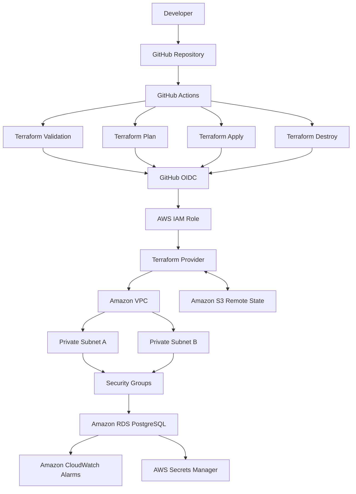

# AWS DevOps Platform — Terraform & GitHub Actions

**Infrastructure as Code · CI/CD Automation · AWS Networking · Drift Detection · Secure Cloud Operations**

An AWS DevOps portfolio project demonstrating how to provision, validate, deploy, monitor, troubleshoot, and destroy cloud infrastructure using Terraform and GitHub Actions.

The project combines AWS infrastructure automation with GitHub Actions CI/CD, OpenID Connect (OIDC) authentication, remote Terraform state management, private database networking, CloudWatch monitoring, infrastructure drift detection, and controlled teardown.

**Technology stack**


**Repository:** [imed3721/aws-devops-platform](https://github.com/imed3721/aws-devops-platform)

---

## Table of Contents

- [Project Overview](#project-overview)
- [Objectives](#objectives)
- [Architecture](#architecture)
- [AWS Infrastructure](#aws-infrastructure)
- [Security and Access Control](#security-and-access-control)
- [CI/CD and Terraform Workflows](#cicd-and-terraform-workflows)
- [Infrastructure Drift Detection](#infrastructure-drift-detection)
- [Cleanup and Final State](#cleanup-and-final-state)
- [Repository Structure](#repository-structure)
- [Project Evidence and Screenshots](#project-evidence-and-screenshots)
- [Key Skills Demonstrated](#key-skills-demonstrated)
- [Challenges and Lessons Learned](#challenges-and-lessons-learned)
- [Cost Management](#cost-management)
- [Future Improvements](#future-improvements)

## Project Overview

This project demonstrates an Infrastructure as Code (IaC) workflow for managing AWS development infrastructure using Terraform and GitHub Actions.

Instead of manually creating and managing cloud resources through the AWS Management Console, the infrastructure is defined in Terraform configuration files and managed through automated workflows.

GitHub Actions handles Terraform validation, planning, deployment, and controlled destruction. GitHub OIDC provides federated authentication to AWS through an IAM role, avoiding the need to store long-lived AWS access keys in GitHub repository secrets.

The project also explores infrastructure drift: what happens when the real AWS environment differs from the Terraform configuration, how that difference can be identified, and how the intended configuration can be restored.

The final stage focuses on controlled teardown and verification that the development infrastructure has been removed.

## Objectives

The main objectives of this project are to:

- Define AWS infrastructure using reusable, version-controlled Terraform configuration.
- Automate infrastructure validation and deployment through GitHub Actions.
- Authenticate securely to AWS using GitHub Actions OIDC and IAM role assumption.
- Store Terraform state remotely in Amazon S3.
- Deploy a private Amazon RDS for PostgreSQL database within an isolated network.
- Apply security group rules to restrict database access.
- Configure CloudWatch alarms for database CPU utilisation and available storage.
- Investigate infrastructure drift and Terraform reconciliation.
- Implement a manually triggered Terraform destruction workflow.
- Verify infrastructure cleanup while retaining the remote state backend.

## Architecture

The following diagram illustrates the main components and how they interact.



The diagram represents the intended infrastructure and workflow design. The deployed resources are documented in the project evidence below.

## AWS Infrastructure

The Terraform configuration manages the following AWS resources.

| Component | Purpose |
|---|---|
| Amazon VPC | Provides an isolated virtual network for development infrastructure. |
| Private subnets | Provide private network placement across two subnets. |
| Security groups | Control network traffic between infrastructure components. |
| Amazon RDS for PostgreSQL | Provides a managed relational database. |
| RDS DB subnet group | Defines the subnets available to the database. |
| Amazon CloudWatch alarms | Monitor database CPU utilisation and free storage. |
| AWS Secrets Manager | Manages the RDS master password through AWS-managed integration. |
| Amazon S3 | Stores the remote Terraform state and state lock file. |

### Network configuration

The development VPC uses the `10.20.0.0/16` IPv4 CIDR range.

Two subnets are configured:

- `10.20.1.0/24`
- `10.20.2.0/24`

The network configuration provides the foundation for private database placement and security group-based traffic restrictions.

### Database configuration

The project uses Amazon RDS for PostgreSQL with the following configuration:

- Database engine: PostgreSQL.
- Instance class: `db.t3.micro`.
- Public accessibility: Disabled.
- Storage encryption: Enabled.
- Master password management: AWS Secrets Manager integration.
- Network placement: RDS DB subnet group using the configured subnets.

The database security group restricts PostgreSQL ingress on port `5432` to the application security group rather than allowing unrestricted inbound database access.

### Monitoring

Two CloudWatch alarms are configured for the database:

| Alarm | Threshold | Purpose |
|---|---:|---|
| High CPU utilisation | 80% | Identifies elevated database CPU utilisation. |
| Low free storage | 2 GiB | Identifies when available database storage falls below the configured threshold. |

These alarms demonstrate how operational monitoring resources can be defined and managed alongside the infrastructure they monitor.

## Security and Access Control

Security is incorporated into both the infrastructure configuration and deployment workflow.

### GitHub Actions OIDC

GitHub Actions assumes an AWS IAM role using OpenID Connect. This avoids storing long-lived AWS access keys in GitHub for the workflow to use.

The role's trust policy restricts which GitHub repository context can assume the role, including the configured branch and deployment environment.

### IAM permissions

The IAM role uses an identity-based policy to grant the AWS API permissions required by Terraform.

The policy covers the relevant operations for:

- VPCs, subnets, security groups, and network interface discovery.
- RDS instances and DB subnet groups.
- CloudWatch alarms.
- Terraform state and state locking in Amazon S3.
- Supporting AWS services required by the configured deployment.

The workflow requires sufficient permissions for both provisioning and destruction. Missing permissions can cause partial cleanup, so IAM changes should be based on actual workflow errors and follow least-privilege principles.

### Remote state

Terraform state is stored in Amazon S3 using the configured backend:

- Bucket: `aws-devops-state-demi`
- State key: `aws-devops-platform/dev/terraform.tfstate`
- State locking: S3 lock file enabled.

The remote state allows Terraform workflows to track managed infrastructure between runs. The state bucket is retained after destroying the development resources so it remains available for subsequent Terraform operations.

## CI/CD and Terraform Workflows

GitHub Actions automates the Terraform lifecycle through separate workflows.

| Workflow | Responsibility |
|---|---|
| Terraform Validation | Checks the Terraform configuration. |
| Terraform Plan | Previews proposed infrastructure changes. |
| Terraform Apply | Creates or updates infrastructure. |
| Terraform Destroy | Manually initiates infrastructure removal. |

### Deployment process

The automated deployment follows these steps:

1. A GitHub Actions workflow is triggered.
2. The repository is checked out.
3. Terraform is installed at the configured version, `1.10.5`.
4. GitHub Actions authenticates to AWS through OIDC and the configured IAM role.
5. Terraform initialises using the Amazon S3 remote backend.
6. The relevant workflow executes Terraform validation, planning, or application.
7. The workflow logs provide evidence of the result.

### Terraform validation

Validation checks help identify configuration problems before infrastructure changes are applied.

### Terraform plan

The plan workflow previews the changes Terraform proposes to make. This helps identify unexpected additions, modifications, or deletions before deployment.

### Terraform apply

The apply workflow uses the configured AWS role to create or update the development infrastructure according to the Terraform configuration.

### Terraform destroy

The destroy workflow is manually triggered and requires the exact confirmation text `DESTROY`.

It initialises Terraform, previews the resources proposed for removal, and executes the destruction operation.

Because infrastructure destruction is a high-impact action, it should be run deliberately, with the plan and execution logs reviewed. The confirmation input helps reduce accidental execution, but it does not replace appropriate environment protection and review controls.

## Infrastructure Drift Detection

Infrastructure drift occurs when the actual AWS resources no longer match the configuration and state Terraform expects to manage.

This project includes a drift-testing process to demonstrate how changes made outside the normal Terraform workflow can be identified and reconciled.

The process consists of three stages:

1. **Introduce drift:** Make a controlled change to a managed resource outside Terraform.
2. **Detect drift:** Run a Terraform plan and inspect the proposed changes.
3. **Reconcile:** Apply the intended configuration when appropriate and verify that the resource has returned to the expected state.

The screenshots in Section D document this process.

Drift detection is important because manual changes can create configuration inconsistencies, weaken security controls, and make future deployments less predictable.

A Terraform plan helps reveal differences, but the result depends on the resource, provider behaviour, current state, and whether the change is represented in the configuration. Plans should therefore be reviewed rather than applied automatically without consideration.

## Cleanup and Final State

The project includes a dedicated GitHub Actions workflow for removing the development infrastructure.

The cleanup process demonstrates:

- Manual workflow triggering.
- Explicit confirmation before destructive execution.
- Terraform's destroy planning and execution.
- Troubleshooting permissions required to remove AWS resources.
- Verification that the intended resources have been removed.
- Retention of the remote Terraform state backend.

During the initial cleanup attempt, deletion of network resources failed because the workflow role lacked `ec2:DescribeNetworkInterfaces`. The IAM policy was updated to address that specific permission error.

This illustrates an important operational lesson: successful provisioning does not automatically guarantee successful destruction. Terraform needs appropriate permissions to inspect dependencies and remove resources in the correct order.

**Final-state verification should be based on the successful destroy run and checks in the AWS Console.** Screenshots captured while the infrastructure was running should be treated as deployment evidence, not proof that those resources still exist after cleanup.

The S3 backend and Terraform state should not be deleted as part of the ordinary development infrastructure teardown.

## Repository Structure

The repository is organised around Terraform infrastructure code and GitHub Actions workflows.

```text
aws-devops-platform/
├── .github/
│   └── workflows/
│       ├── terraform-validate.yml
│       ├── terraform-plan.yml
│       ├── terraform-apply.yml
│       └── terraform-destroy.yml
├── infra/
│   └── Terraform configuration and backend files
├── screenshots/
│   ├── A1-repository-structure.png
│   ├── A2-terraform-code.png
│   ├── B1-validation.png
│   ├── B2-terraform-plan.png
│   ├── B3-terraform-apply.png
│   ├── C1-vpc-and-subnets.png
│   ├── C2-rds-and-security-groups.png
│   ├── C3-cloudwatch-alarms.png
│   ├── D1-drift-created.png
│   ├── D2-drift-detected-in-plan.png
│   ├── D3-drift-remediated.png
│   ├── E1-destroy-workflow.png
│   ├── E2-destroy-success.png
│   └── E3-aws-cleanup-verification.png
└── README.md
```

The screenshot filenames above are suggested examples. Adjust the structure and names to match the actual files committed to the repository.

## Project Evidence and Screenshots

This section documents the implementation through five groups of screenshots.

The images should be uploaded to the repository's `screenshots/` directory. Each Markdown image path must match the corresponding filename and capitalisation exactly.

### A. GitHub Repository and Terraform Code

This section demonstrates the repository structure, infrastructure configuration, and version-controlled implementation.

**A1 — Repository structure**

Shows the project folders, Terraform files, and GitHub Actions workflow directory.

 

**A2 — Terraform code**

Shows representative Terraform configuration used to define the AWS infrastructure.

 

 

 

 

 

### B. CI/CD and Terraform Deployment

This section demonstrates the automated workflow from validation to deployment.

**B1 — Terraform validation**

Shows the validation workflow and its result.

 

 

 

**B2 — Terraform plan**

Shows Terraform previewing the proposed infrastructure changes.

 

 

 

**B3 — Terraform apply**

Shows the deployment workflow and the Terraform apply result.

 

 

 


### C. Live AWS Infrastructure

These screenshots document the AWS resources provisioned during the deployment stage.

**C1 — VPC and subnets**

Shows the development VPC and its configured subnets.


**C2 — RDS and security groups**

Shows the database configuration and relevant network security controls.


**C3 — CloudWatch alarms**

Shows the database monitoring alarms and their configured thresholds.


### D. Infrastructure Drift

This section documents the controlled drift test and reconciliation process.

**D1 — Drift introduced**

Shows the controlled change made outside Terraform.

 

 

 

 

**D2 — Drift detected**

Shows the Terraform plan identifying the difference between the expected and actual configuration.

 

 

**D3 — Drift remediated**

Shows the result after the intended configuration has been restored and verified.

 

 

 


### E. Cleanup and Final State

This section documents the controlled teardown and verification of the development environment.

**E1 — Destroy workflow**

Shows the manually triggered Terraform Destroy workflow and its confirmation requirement.


**E2 — Destroy completed**

Shows the successful Terraform destroy execution.


**E3 — AWS cleanup verification**

Shows the AWS Console evidence confirming that the intended development resources have been removed.


*Only include screenshots that exist and accurately support the claims above. If cleanup or drift remediation is still in progress, update this section when you have verified the result.*

## Key Skills Demonstrated

This project demonstrates practical experience with:

- **Infrastructure as Code:** Defining AWS resources with Terraform.
- **CI/CD automation:** Managing infrastructure workflows with GitHub Actions.
- **Cloud authentication:** Configuring GitHub OIDC and AWS IAM role assumption.
- **AWS networking:** Creating a VPC, subnets, and security groups.
- **Database infrastructure:** Deploying and configuring Amazon RDS for PostgreSQL.
- **Cloud security:** Restricting database access and enabling storage encryption.
- **Remote state management:** Using Amazon S3 and state locking.
- **Monitoring:** Configuring CloudWatch alarms.
- **Drift management:** Identifying and reconciling infrastructure differences.
- **Operational troubleshooting:** Investigating IAM permission failures and resource dependencies.
- **Infrastructure lifecycle management:** Planning, applying, and destroying development resources.
- **Technical documentation:** Recording architecture, implementation, and verification evidence.

## Challenges and Lessons Learned

### IAM permissions must support the complete lifecycle

The initial destroy attempt exposed a missing EC2 network-interface discovery permission. Addressing the specific permission was necessary before Terraform could continue removing the remaining network resources.

### Remote state is essential for repeatable operations

Terraform relies on its state to track managed resources. Retaining the S3 backend helps maintain continuity across workflow runs and supports subsequent infrastructure operations.

### Private networking reduces exposure

The database is configured without public accessibility, and PostgreSQL ingress is restricted to the application security group. These controls demonstrate the principle of limiting network access to what is required.

### Plans and destructive operations require review

Terraform plans provide useful visibility into proposed changes. A manually triggered destroy workflow adds a deliberate step before teardown, but safe operation still depends on reviewing the changes and verifying the outcome.

### Evidence makes the implementation easier to evaluate

Organising screenshots by repository, deployment, live infrastructure, drift, and cleanup makes it easier for reviewers to follow the project lifecycle and understand the practical work involved.

## Cost Management

AWS resources may incur charges while they are running, particularly managed database instances and related storage.

The project uses a development environment and includes a Terraform destroy workflow to support cleanup when the infrastructure is no longer needed.

After teardown:

- Confirm the destroy workflow completed successfully.
- Verify the intended VPC, subnets, security groups, RDS resources, and CloudWatch alarms have been removed.
- Check for any separately managed resources or backups that may remain.
- Retain the remote state bucket unless you intentionally decide to decommission the Terraform backend.

The destroy workflow removes resources managed by the Terraform configuration; it does not guarantee that every potentially billable resource in the AWS account has been removed.

## Future Improvements

Potential next steps for this project include:

- Add automated Terraform formatting and validation checks to pull requests.
- Introduce separate development and production environments.
- Configure mandatory reviewer approval for sensitive deployment and destruction workflows.
- Further refine IAM permissions to follow least-privilege principles.
- Add automated security scanning for Terraform configuration.
- Add more comprehensive monitoring, logging, and alert notifications.
- Improve the destroy workflow by saving and reviewing a specific destroy plan before execution.
- Add automated tests and documented recovery procedures.

## Conclusion

The AWS DevOps Platform demonstrates an end-to-end approach to managing cloud infrastructure through code and automated workflows.

By combining Terraform, GitHub Actions, OIDC authentication, private AWS networking, database monitoring, drift detection, and controlled teardown, the project illustrates key DevOps practices across the infrastructure lifecycle.

The repository and screenshot evidence provide a practical record of the implementation, the challenges encountered, and the operational processes used to manage the environment.

**Source code:** [github.com/imed3721/aws-devops-platform](https://github.com/imed3721/aws-devops-platform)
